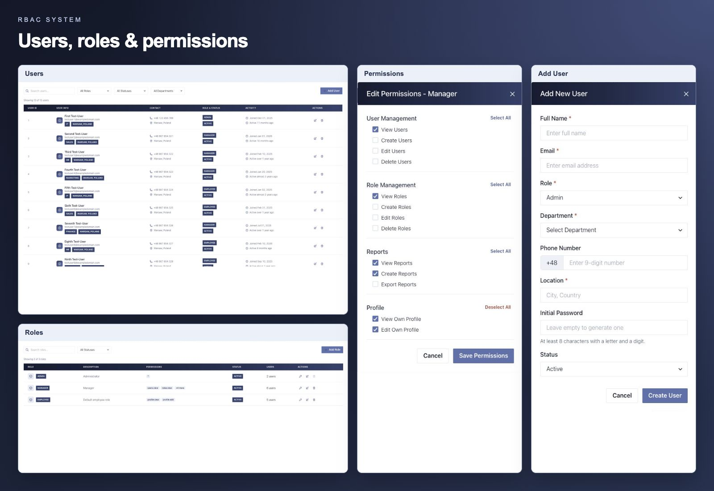
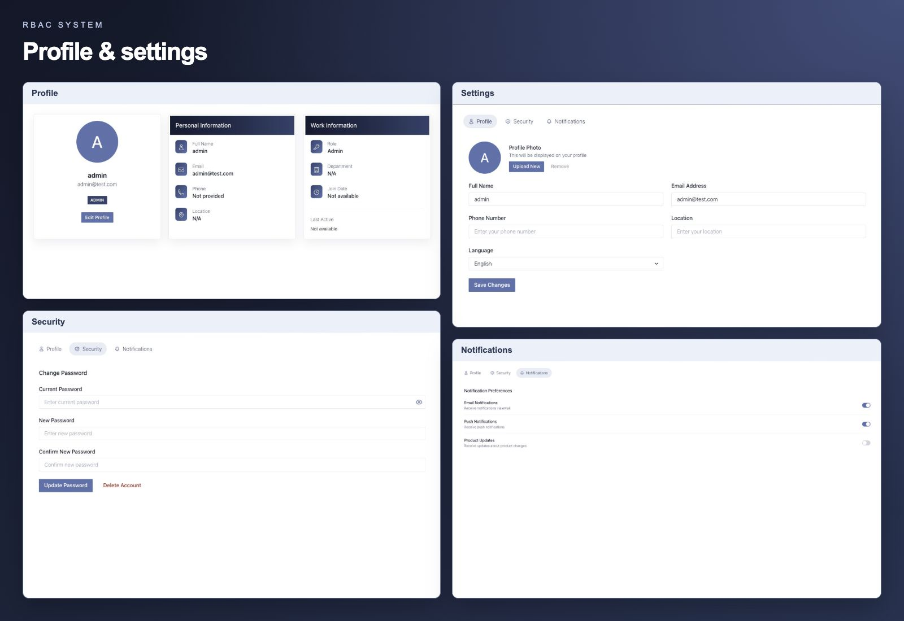
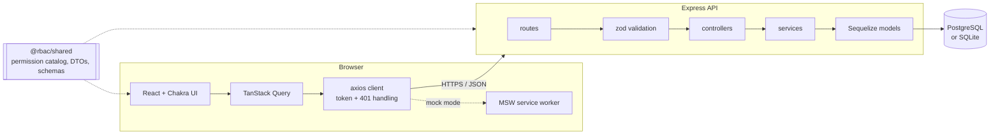

# RBAC System

A full-stack role-based access control system: manage users, roles and
permissions through a React dashboard backed by a TypeScript/Express API.

**Live demo (frontend in mock mode):** https://zkvxg-rbac-system.vercel.app/

| Account  | Email             | Password  |
| -------- | ----------------- | --------- |
| Admin    | admin@test.com    | `test123` |
| Manager  | manager@test.com  | `test123` |
| Employee | employee@test.com | `test123` |

## Features

- **Users** – CRUD, role assignment, activation, search, filters, server-side pagination
- **Roles** – custom roles built from a fixed permission catalog
- **Permission-aware UI** – navigation, routes and buttons follow the signed-in user's permissions
- **Safety rules** – no self-deletion, the last active administrator cannot be removed, only superusers can grant `*`
- **Mock mode** – the frontend runs without a backend; an in-browser mock API answers the same calls
- **Departments and analytics** – frontend-only demo screens

## Interface overview






## Architecture



The repository is an npm workspaces monorepo:

```
apps/api         Express API (TypeScript, Sequelize, zod, pino)
apps/web         React app (TypeScript, Vite, Chakra UI, TanStack Query, MSW)
packages/shared  permission catalog, DTO types and validation rules used by both
```

## Permission model

- A **permission** is a key from a fixed catalog (`users.view`, `roles.edit`, …), defined once in `@rbac/shared`.
- A **role** holds a set of permissions (`Roles` ↔ `Permissions` through `RolePermissions`).
- A **user** has one role. A role holding `*` is a superuser role and passes every check.
- The JWT carries only the user id. Role and permissions are read from the database on every request, so role changes and deactivation apply immediately.

Every protected endpoint declares the permission it needs; see the API docs.

## Getting started

Requirements: Node.js 20+ (see `.nvmrc`).

```bash
npm install            # also builds @rbac/shared
```

### Frontend only (mock mode)

```bash
npm run dev:web        # http://localhost:5173
```

With `VITE_USE_MOCKS` unset or `true`, a mock service worker answers all API calls.

### Full stack

```bash
cp apps/api/.env.example apps/api/.env          # set JWT_SECRET
cp apps/web/.env.example apps/web/.env.local    # set VITE_USE_MOCKS=false

docker compose up -d   # PostgreSQL (optional: without DATABASE_URL the API uses SQLite)
npm run dev:api        # http://localhost:5000, migrates and seeds in development
npm run dev:web
```

API docs (OpenAPI 3.1, Swagger UI): http://localhost:5000/api/docs

On macOS port 5000 is taken by AirPlay; set `PORT=5001` in `apps/api/.env` and point `VITE_API_URL` at it.

## Scripts

| Command                                       | What it does                                                              |
| --------------------------------------------- | ------------------------------------------------------------------------- |
| `npm run dev:api` / `npm run dev:web`         | Start the API (tsx watch) / the web app (Vite)                            |
| `npm run lint` · `npm run typecheck`          | ESLint · TypeScript across all workspaces                                 |
| `npm run test:unit` · `npm run test:coverage` | Vitest unit tests (with coverage thresholds)                              |
| `npm run test:api`                            | API unit + integration tests                                              |
| `npm run test:web`                            | Playwright end-to-end tests                                               |
| `npm run db:migrate -w @rbac/api`             | Apply migrations (also `db:seed`, `db:migrate:status`, `db:migrate:undo`) |

Integration tests use SQLite by default; set `TEST_DATABASE_URL` to run them against PostgreSQL.

## Testing

| Layer      | Tool                     | Where                       |
| ---------- | ------------------------ | --------------------------- |
| Unit       | Vitest                   | `apps/*/**/__tests__`       |
| Components | Vitest + Testing Library | `apps/web/src/**/__tests__` |
| API        | Playwright request API   | `apps/api/tests`            |
| End-to-end | Playwright (3 browsers)  | `apps/web/tests/e2e`        |

CI runs lint, typecheck, unit tests with coverage thresholds, API tests on SQLite and PostgreSQL (including a migration rollback check) and the E2E suite.

## Configuration

API (`apps/api/.env`, validated on startup):

| Variable          | Default                 | Purpose                                               |
| ----------------- | ----------------------- | ----------------------------------------------------- |
| `JWT_SECRET`      | –                       | Token signing key, required (32+ chars in production) |
| `DATABASE_URL`    | SQLite file             | PostgreSQL connection string                          |
| `PORT`            | `5000`                  | HTTP port                                             |
| `CORS_ORIGINS`    | `http://localhost:5173` | Comma-separated allowed origins                       |
| `DB_AUTO_MIGRATE` | `true` in development   | Migrate and seed on startup                           |
| `API_DOCS`        | off in production       | Serve `/api/docs`                                     |

See `apps/api/.env.example` for the rest. In production run `node dist/db/cli.js migrate` before starting `node dist/server.js`; the server refuses to start with pending migrations.
